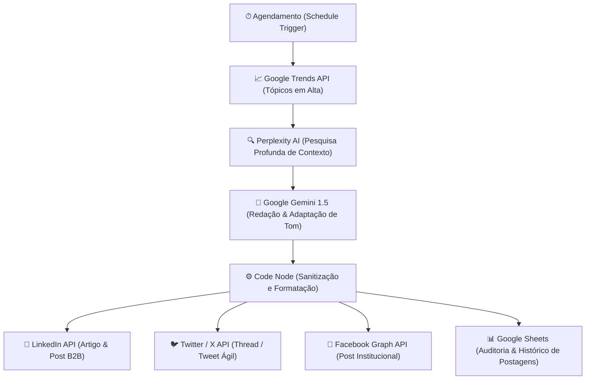

# 📡 TrendPulse AI — Autonomous Trend Research & Multichannel Publisher

  
  
  
  

Agente autônomo de inteligência de tendências e publicação multicanal desenvolvido em **n8n**. Ele minera tópicos em alta em tempo real, executa pesquisa aprofundada via **Perplexity AI**, sintetiza artigos e postagens executivas com **Google Gemini** e publica de forma totalmente autônoma no **LinkedIn, Twitter/X e Facebook**, registrando métricas em planilha.

---

## 💡 O Problema de Negócio

Equipes de marketing gastam em média **15 a 20 horas por semana** monitorando o que é tendência, buscando fontes confiáveis, escrevendo cópias adaptadas por rede social e postando manualmente. Esse processo é lento, caro e perde o timing da notícia.

---

## ⚡ A Solução: Pipeline de 18 Nós

---

## 🎯 ROI & Impacto Operacional

* **Economia de tempo:** Redução de ~15h semanais para zero no trabalho braçal de pesquisa e publicação.
* **Cobertura multicanal:** Presença ativa e instantânea em 3 grandes redes sociais no momento em que a tendência surge.
* **Consistência:** 100% das postagens seguem o playbook de tom e voz institucional orquestrado via prompt engineering no Gemini.

---

## 📂 Arquivos do Repositório

* `workflow.json`: Exportação oficial do fluxo pronta para importação no n8n.
* `README.md`: Especificação técnica e de negócio.

---

## 🚀 Como Usar no n8n

1. Baixe o arquivo `workflow.json`.
2. No seu n8n, crie um novo workflow e clique em **Import from File**.
3. Configure suas credenciais nos nós correspondentes:
   * **Perplexity API:** chave em `Research Topic- Perplexity`.
   * **Google Gemini:** API Key do Google AI Studio.
   * **LinkedIn / Twitter / Facebook:** Contas OAuth conectadas.
   * **Google Sheets:** Conexão Google Drive / Sheets para log.
4. Ative o fluxo para execução automática diária!

---

## 👨‍💻 Autor

Desenvolvido por **[Cauã Ribeiro](https://github.com/CauaRibeiroXY)**  
*Acadêmico de Ciência da Computação (IFNMG) • AI Builder & Engenheiro de Software*
